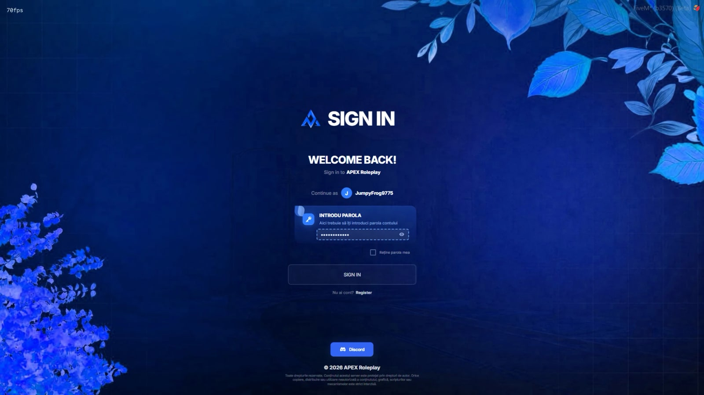
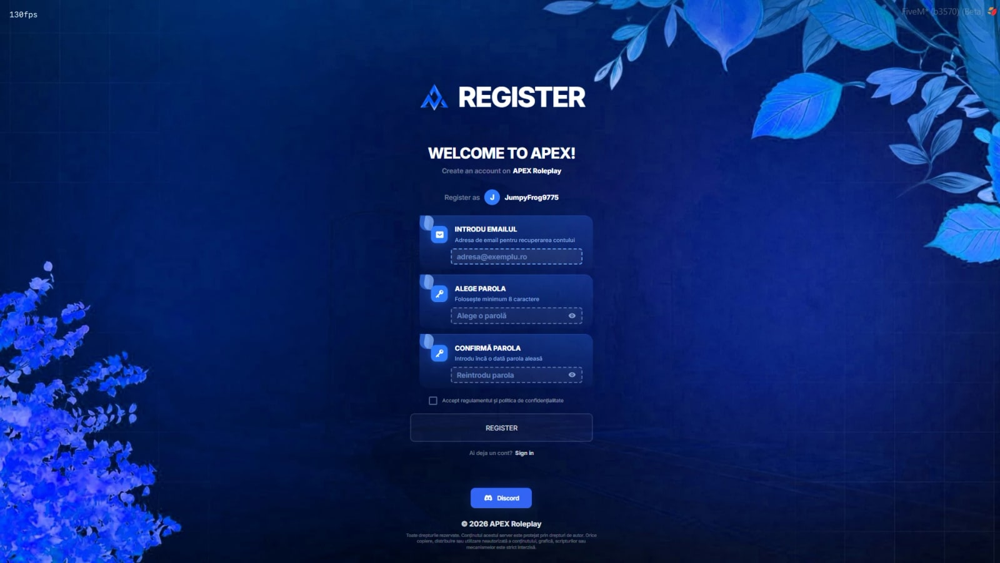

# PULSE-LOGIN

**A modern login and register system with account recovery.**

  

[**Get it on Discord**](https://discord.gg/HmjEXhPF3Q) &nbsp;•&nbsp; [**All Pulse Store products**](https://github.com/amiculap/pulse-portfolio)

> 🔒 This page is a **showcase**. The source code is private and is delivered only after purchase.

---

## Overview

PULSE-LOGIN is a login and register system for **vRP** servers. Players create an account, sign in and recover access by email, all through a modern and intuitive interface.

## Preview

  
  

## Highlights

- 🔐 **Login & register** — A complete sign-in and registration flow.
- 📧 **Account recovery** — Email for account recovery.
- 💾 **Remember me** — “Remember my password” option.

## Features

### Accounts

- Login & Register system
- Accounts stored in **MongoDB**
- Email for account recovery
- “Remember my password” option

### Interface & setup

- Modern and intuitive interface
- Easy to configure and customize

### After purchase

- Support included after purchase

## Compatibility

| | |
| :-- | :-- |
| **Framework** | vRP |
| **Database** | MongoDB |

## What you get

- The complete resource, tested and fully functional
- Support after purchase through the official ticket system
- Free updates for bug fixes
- A license for your server / community

## Get it

**Price: 5€**

1. Join the [Pulse Store Discord](https://discord.gg/HmjEXhPF3Q)
2. Open a ticket in **#tickets**
3. Tell us what you need and get the details

Payments: bank transfer, Revolut, LTC, Paysafe.

---

[← Back to the Pulse Store portfolio](https://github.com/amiculap/pulse-portfolio) &nbsp;•&nbsp; © 2026 Pulse Store — all rights reserved. See [LICENSE](LICENSE).

